# pretty-git-tree

Turn a slice of git history into a diagram worth looking at.

**[hmillerbakewell.github.io/pretty-git-tree](https://hmillerbakewell.github.io/pretty-git-tree/)**

Pick a time range, run the `git log` command the page builds in your own clone, paste what it prints, and download a picture of the real commit graph as PNG or SVG.
Useful for brag posts and team updates first, but also as generative art.

## No git data apart from the shape

The command prints each commit's id, time and parents, and marks HEAD, which is
how the trunk is found:

```sh
git log --all --no-color --decorate-refs=HEAD --since=2026-09-21T00:00 --until=2026-09-27T23:59:59 '--format=%H %ct %P%d'
```

This is only the data needed to construct the diagram.
No branch or tag names, no authors, no messages, so a picture of a work repo gives nothing away.
You copy what it prints yourself, or save it to a file and drop that on the page.

The page never reads a repository or GitHub, and there's no server: the
paste is the only way in, and it stays in your browser's local storage. A week
or so of git, postgres, linux, rust, go and curl from early 2026 is bundled as
examples, under "Examples".

## Styles

All drawn from the same week of git (early March 2026). The page offers these
four:

| | |
|---|---|
| 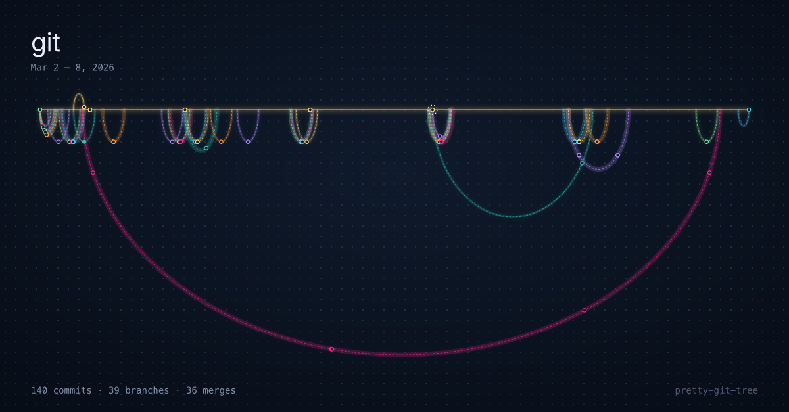<br>**Arches**: One line of time; every branch an arch from fork to merge, open ones hanging below. | 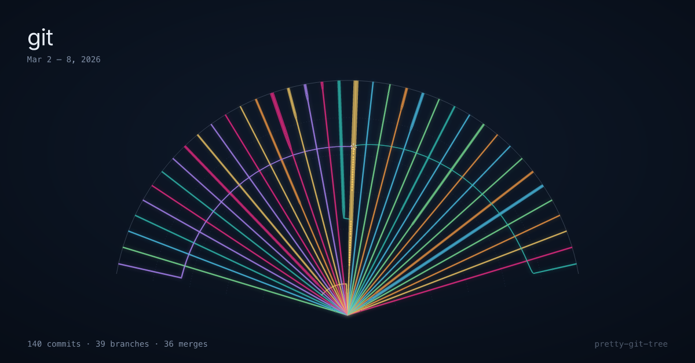<br>**Delta**: A river delta: time flows out from one point, branches as channels fanning to the sea. |
| 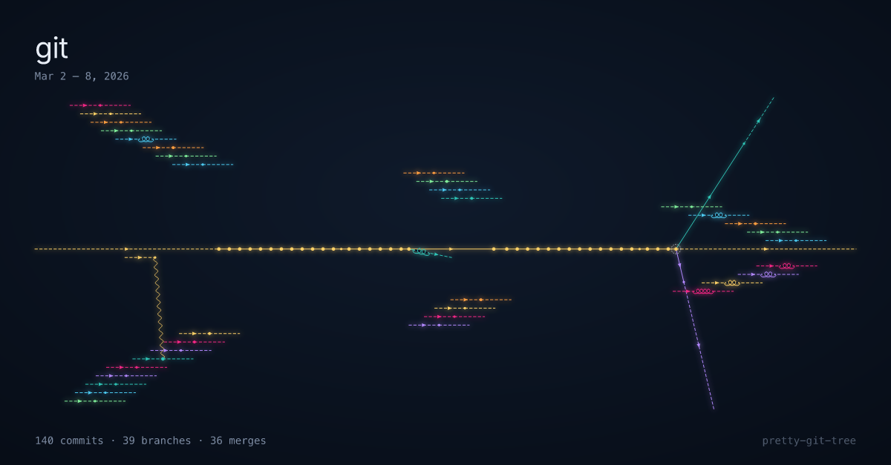<br>**Particles**: A Feynman diagram: branches as fermion lines, forks as pair creation, merges as photons. | 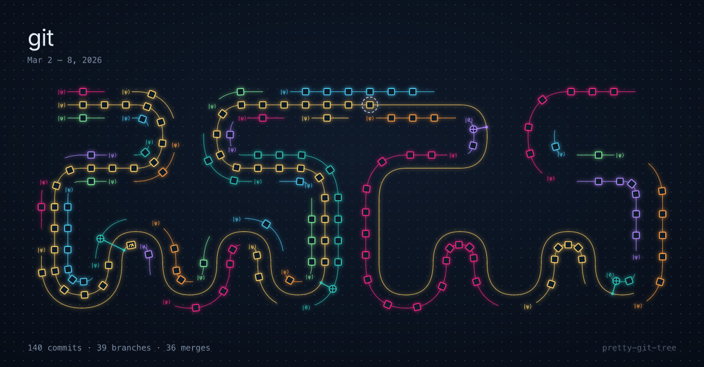<br>**Qubits**: Branches as qubits: merges are CNOTs, and branches reuse wires. |

The rest were tried and left off the page. Their code is in
`src/core/renderers`:

| | |
|---|---|
| 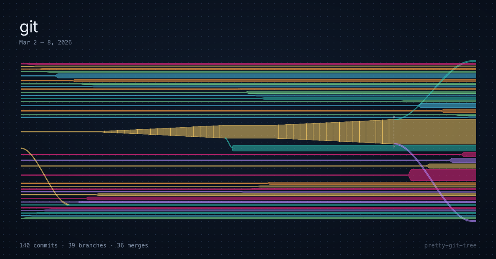<br>**alluvial**: A Sankey diagram: ribbons as wide as the commits they carry, swelling at every merge. | 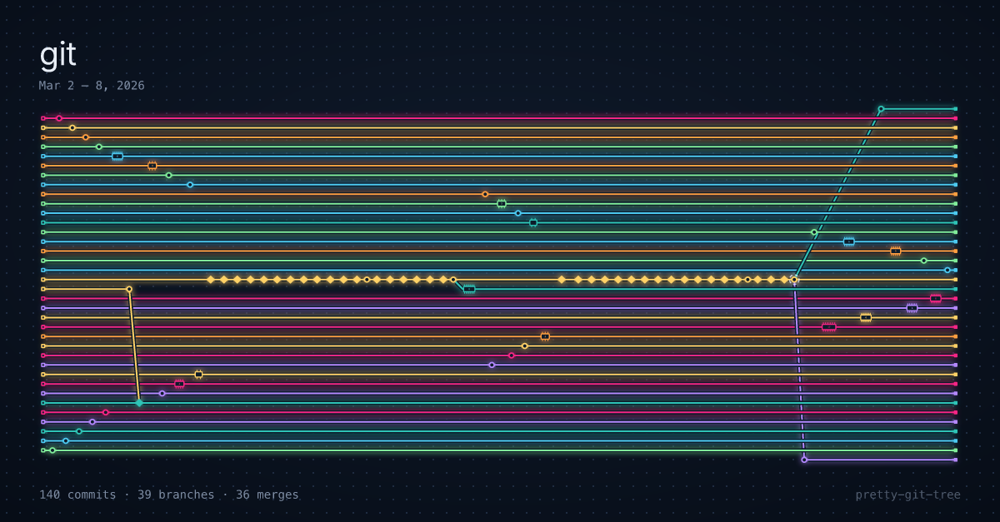<br>**circuit**: Branches as PCB traces: vias, chips, 45-degree bends. |
| 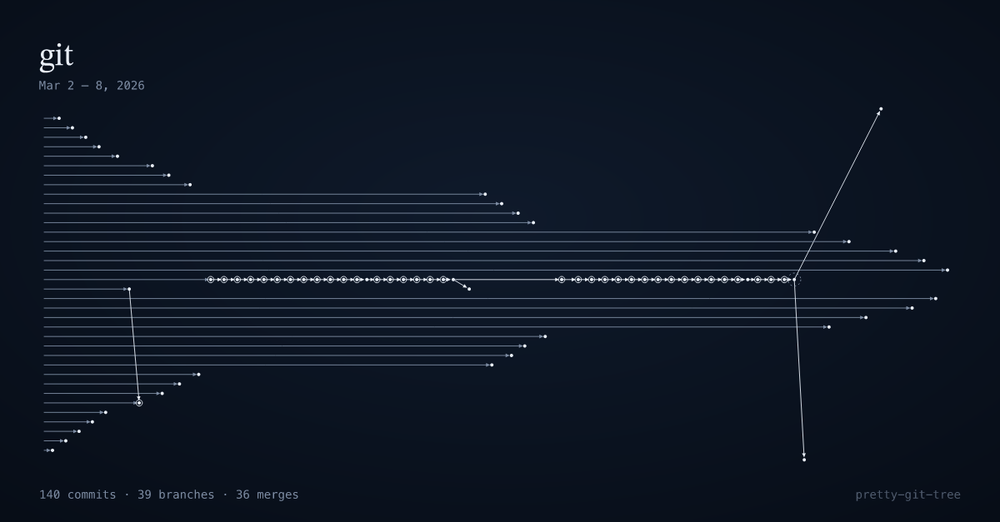<br>**commutative**: Dual view: commits as objects, changes as arrows, merges as pushout squares. | 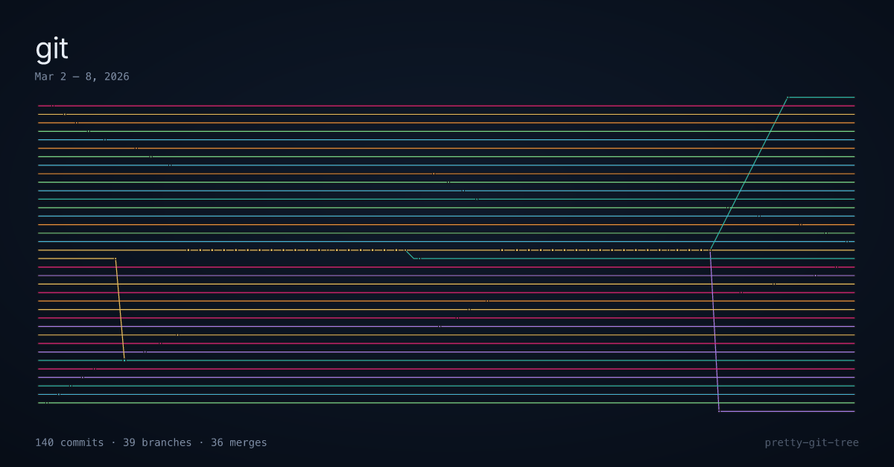<br>**faces**: Merges as stained-glass faces, with the dual graph across them. |
| 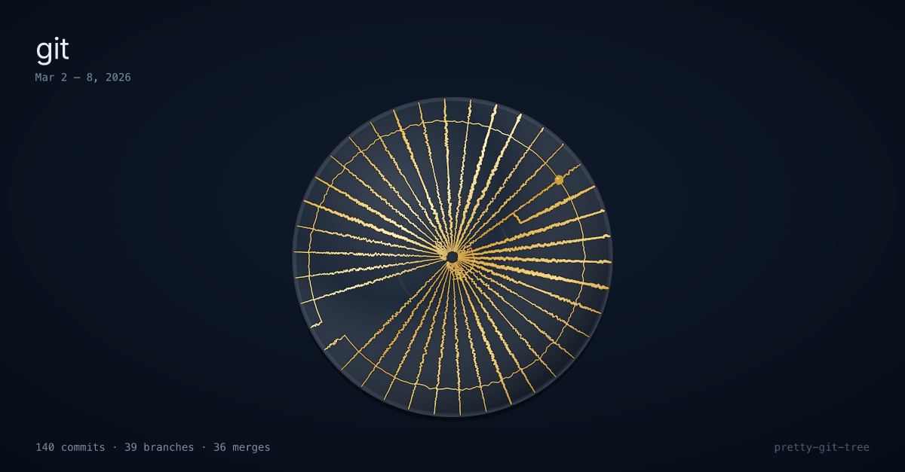<br>**kintsugi**: A mended bowl: branches crack out from the centre, merges close shards, gold holds them. | 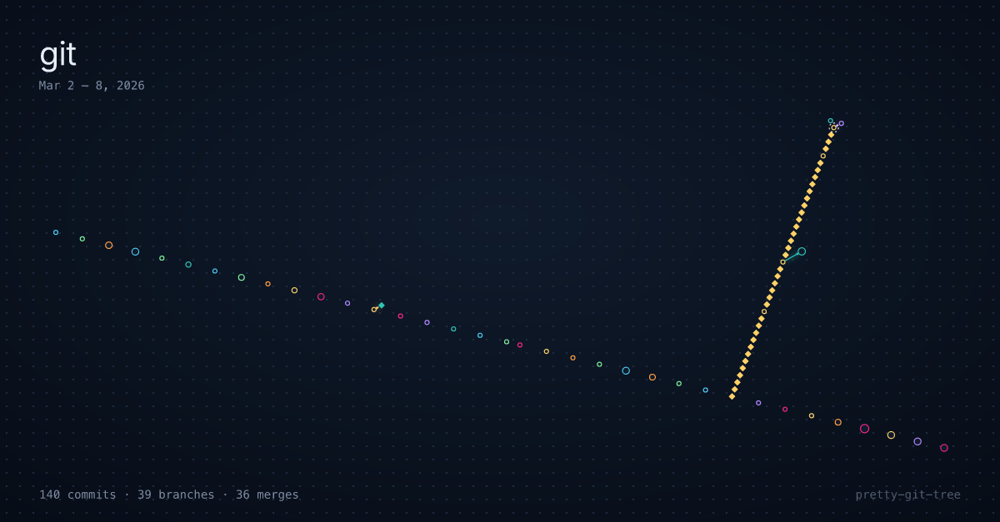<br>**lattice**: Dual view: each branch a direction, merges as closed parallelograms. |
| 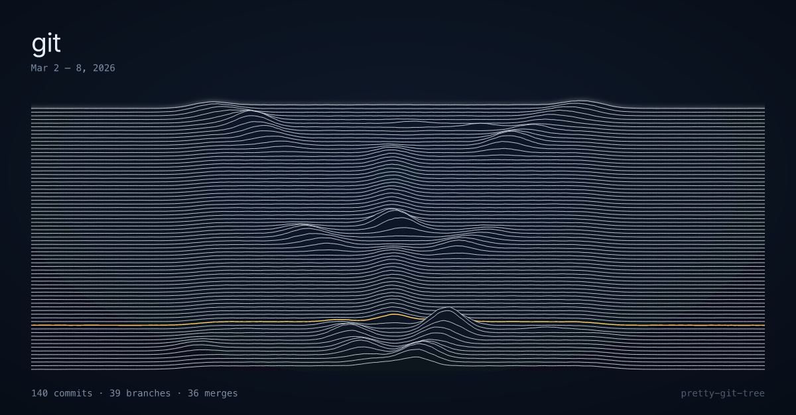<br>**ridgeline**: Rows of time stacked like Unknown Pleasures; each live branch a peak. | 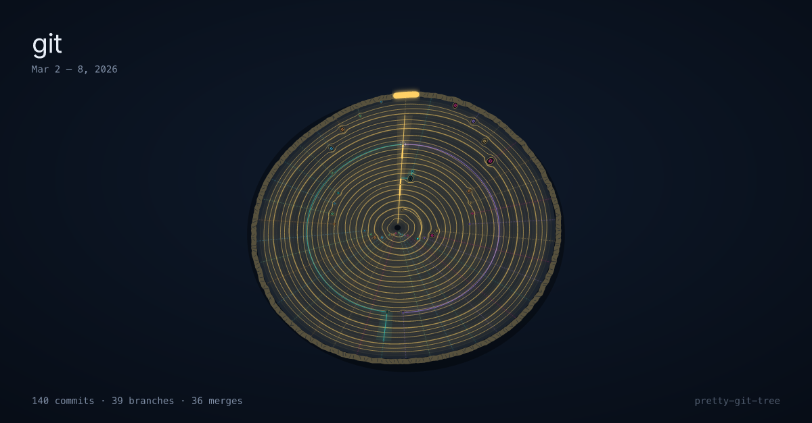<br>**rings**: Tree rings: a sawn trunk, busy periods growing wide rings, branches as sectors that knot where they fork. |
| 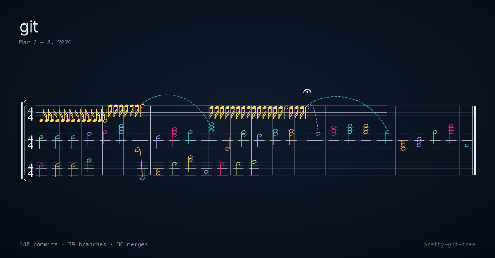<br>**score**: An orchestral score: branches as voices, commits as notes, merges as slurs. | 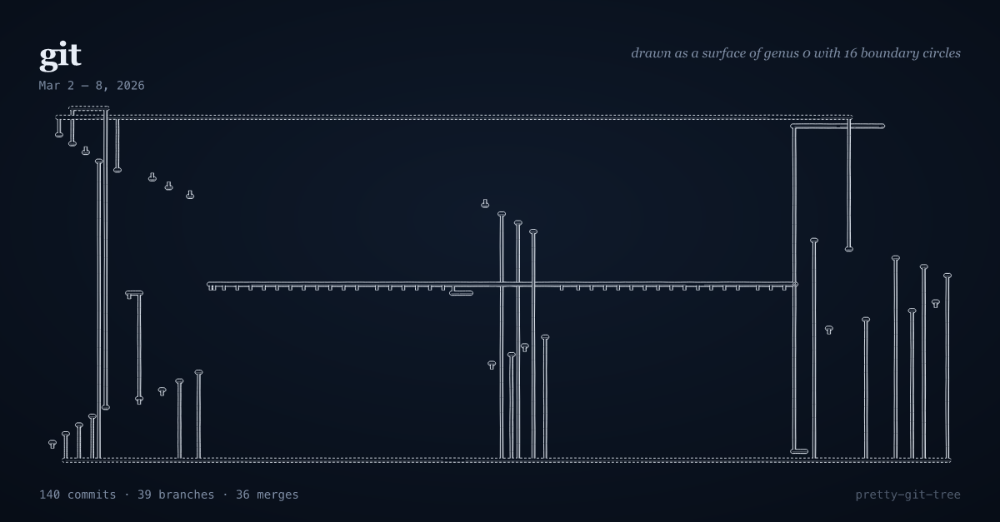<br>**seifert**: The history as a surface: branches are disks, forks and merges bands, drawn as in a topology book. |
| 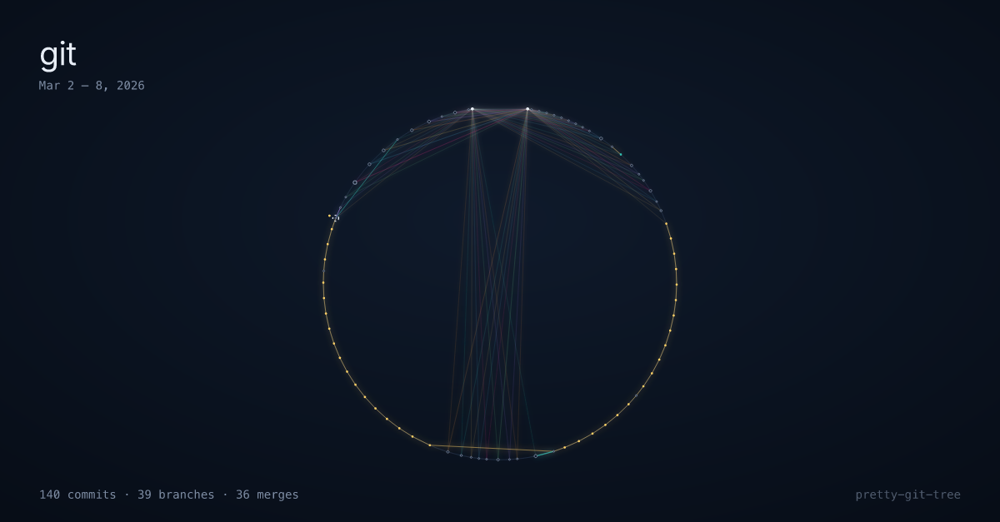<br>**strings**: String art: commits as pins round a circle (or a spiral), every parent link a straight thread. | 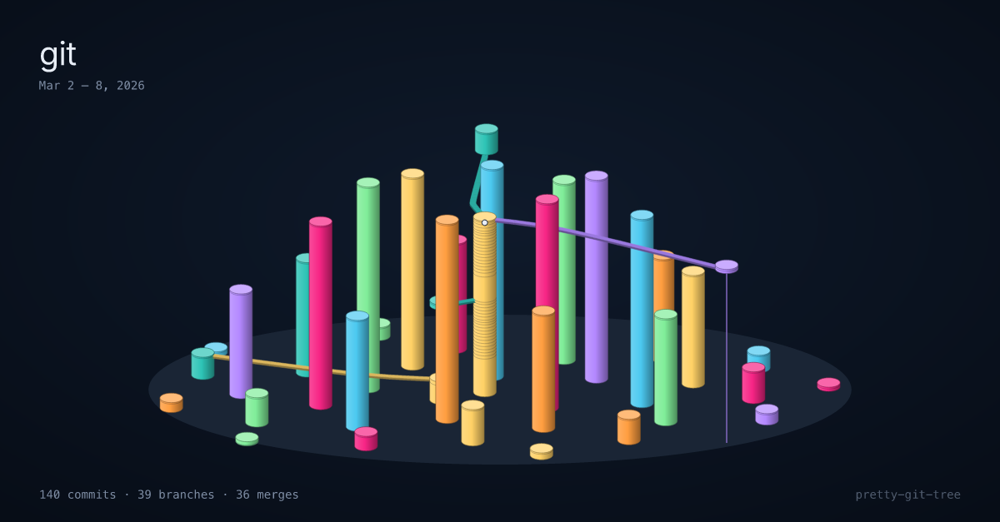<br>**towers**: Branches as round towers, time as height; forks and merges as walkways between them. |
| 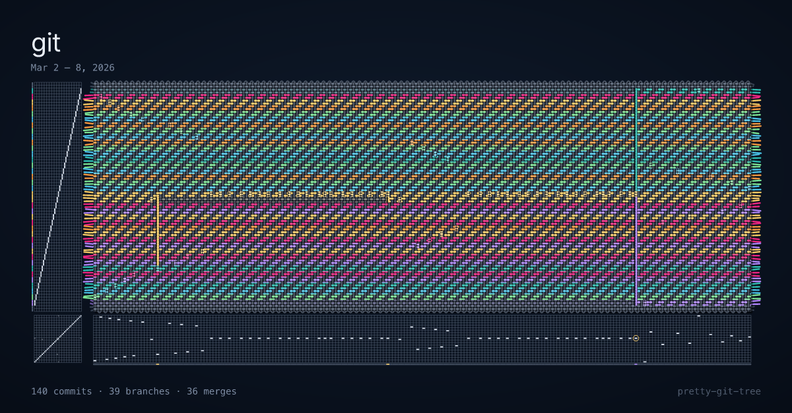<br>**weave**: A weaving draft: branches as warp stripes, time as weft; commits lift, merges float across. | |


## Development

Needs Node 26 (see `.nvmrc`). With [just](https://github.com/casey/just):

```sh
just setup     # npm install
just dev       # the site at http://localhost:5173, plus sample histories in Examples
just test      # run tests
just check     # typecheck
just lint      # lint and check formatting
just build     # static site in dist/web
just preview   # serve the built site
just styles    # redraw the style images in media/styles
```

Or see the npm scripts.

## Analytics

Usage stats only. The page sends anonymous events to PostHog EU: which settings are used, and coarse buckets of commits, branches and merges, just so I can see the (very rough) kinds of projects people are rendering. It does not track the git ids. Under Do Not Track or Global Privacy Control nothing is sent.

## AI Disclaimer

Claude Code was used to help generate the code for this project.

## Licence

[MIT](LICENSE) © 2026 Hector Miller-Bakewell
